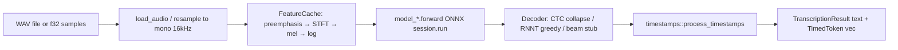

# AGENTS.md — parakeet-rs

Primary reference for AI agents and developers working in this directory.

**Upstream (consume):** [altunenes/parakeet-rs](https://github.com/altunenes/parakeet-rs) — `upstream` remote, fetch/merge only  
**Fork (publish):** [iguy0/parakeet-rs](https://github.com/iguy0/parakeet-rs) — `origin` remote, all pushes go here  
**This copy:** Local checkout under `/home/v2/projects/onnx/parakeet-rs`. Changes should stay mergeable with upstream.

---

## Fork Development Philosophy

This fork exists to **extend and improve** the upstream library — not to maintain a divergent product. Every change should satisfy three goals:

1. **Minimal necessary scope** — Touch only the files and APIs required for the goal. Prefer additive changes (new optional params, new scripts, new Cargo features) over refactors that reshape existing modules.
2. **Generic and portable** — Solutions should work for any developer embedding `parakeet-rs` in their own project without fork-specific wiring. Avoid hardcoded local paths, one-off environment assumptions, or behavior that only makes sense in this workspace. Configuration belongs in function arguments, `ModelConfig`, ONNX metadata, or export CLI flags — not in scattered constants tied to a single deployment.
3. **Upstream-mergeable** — Structure work so it can become an upstream PR: follow existing module layout, match naming/style, gate optional capabilities behind Cargo features, and keep `src/lib.rs` re-exports stable unless there is a compelling, documented API reason.

**Prefer extension over modification:**

| Do | Avoid |
|----|-------|
| Add a new export script alongside existing ones | Rewrite `sortformer.rs` for one model variant when metadata-driven config suffices |
| Add optional `ModelConfig` fields with sensible defaults | Change default chunk sizes or EP behavior for all users |
| Document latency tables in export script headers | Embed workspace-specific model paths in Rust or examples |
| Put experimental tooling in `scripts/` (quantize, 8spk export) | Fork the inference core with copy-pasted `model_*.rs` logic |

When a local experiment proves stable, propose it upstream as a small, focused PR rather than letting the fork accumulate permanent divergence.

---

## Fork & Upstream Sync Policy

### Git remotes

| Remote | URL | Use |
|--------|-----|-----|
| `origin` | `iguy0/parakeet-rs` | **Push all branches and tags.** Default push target. |
| `upstream` | `altunenes/parakeet-rs` | **Fetch and merge only** (`pushurl` disabled). Never push here. |

```bash
git sync-upstream    # fetch upstream + merge upstream/master into current branch
git push-fork        # push current branch to origin (iguy0)
```

**Daily workflow:** develop on `master` (or feature branches) → `git sync-upstream` periodically → `git push origin <branch>`.

| Rule | Rationale |
|------|-----------|
| **Extend with minimal diffs** — smallest change that achieves the goal | Keeps review burden low and merge conflicts rare |
| **Keep changes generic** — no project-specific paths, secrets, or deployment hooks | Other developers should `cargo add parakeet-rs` and use features as documented |
| Keep public API changes minimal and documented | Upstream consumers depend on stable `parakeet_rs` exports in `src/lib.rs` |
| Prefer extending `scripts/` over inlining export logic in Rust | Upstream maintains Python NeMo export scripts; Rust constants must match export params |
| When changing streaming constants (e.g. `CHUNK_SIZE` in `nemotron.rs`), update the matching export script and document latency | Export-time `--right-context` and Rust mel-frame counts must agree |
| Run `cargo build` and `cargo test` before proposing upstream PRs | CI only runs build + test on Ubuntu (`/.github/workflows/rust.yml`) |
| Do not commit ONNX weights, model dirs, or `scripts/__pycache__/` | Models are downloaded separately from HuggingFace |
| Commit `samples/smoke/` only | Small smoke fixture for WebGPU/benchmark tests on any clone; other `samples/` stays local |

**Current local delta (vs `upstream/master`):**

| Path | Status | Notes |
|------|--------|-------|
| `src/decoding/` | Added | Beam search module (`ctc_beam`, `tdt_beam`, `rnnt_beam`) + `DecodingStrategy`/`BeamConfig`; ported from parakeet-mlx defaults. CTC beam also accepts an `ArrayView2` (`decode_ctc_beam_view`). `BeamConfig::frame_topk` (`0` = `beam_size`) is CTC-only; default hypotheses stay the same |
| `src/parakeet.rs`, `src/parakeet_tdt.rs`, `src/parakeet_unified.rs`, `src/nemotron.rs`, `src/model_tdt.rs` | Modified | `from_pretrained_with_decoding` / `set_decoding_strategy` wiring for greedy-vs-beam. Parakeet CTC beam decodes through `ParakeetModel::with_logits` (no owned `T x V` copy) |
| `tests/model_benchmark.rs`, `tests/common/mod.rs` | Added | Model-backed WER/DER smoke + benchmark tests (skip gracefully when weights absent). Granite: `granite_long_audio_completes` (`PARAKEET_BENCH_ALL=1`, ceiling `GRANITE_LONG_MAX_WER` default 0.35), ignored `granite_beam_peak_rss`, `granite_ctc_beam_matches_before` (`PARAKEET_GRANITE_BEAM_BASELINE`) |
| `scripts/benchmark/` | Added | `run_all.sh`, `manifest.toml`, `compare_greedy_beam.py` greedy-vs-beam harness |
| `plans/BEAM_SEARCH_IMPLEMENTATION_PLAN.md` | Added | Design notes for the beam search work |
| `scripts/export_nemotron_streaming.py` | Modified | Export/latency documentation and `--right-context` presets |
| `src/nemotron.rs` | Modified | 560 ms chunk config comment + beam decoding hook; `flush` / `flush_with_tokens` finish the streaming tail (offline last-chunk pad); `#[doc(hidden)] stage_timing_ns` |
| `scripts/quantize_nemotron_streaming.py` | Added | INT8/INT4 quantization tooling (candidate for upstream) |
| `scripts/export_ultra_diar_8spk.py` | Added | 8-speaker Sortformer export |
| `scripts/export_nemotron3_diarization.py` | Added | `nvidia/Nemotron-3-Diarization` export (31-layer RoPE transformer, 8 spk, 99.2M params). Same 6-in/3-out ONNX contract as the other Sortformer exports; presets `offline`/`low`/`verylow`/`ultralow`; swaps NeMo FlexAttention for dense-mask SDPA at export time; stamps cache-compression metadata; optional `--int8-output` + `--compare-wav` |
| `src/sortformer.rs` (metadata) | Modified | `num_speakers` (default 4), plus optional `spkcache_sil_frames_per_spk` (default 3), `scores_boost_latest` (default 0), `sil_emb` (fixed silence embedding replacing the running mean). Absent keys keep legacy behaviour |
| `src/sortformer.rs` (API) | Modified | `SessionRouter` + `set_session_router`; `diarize()` = `predict_raw()` + `post_process()`; `feed_raw`/`flush_raw` (raw 80 ms probabilities); `feed`/`flush` post-process continuously across windows via private `StreamPost` (`set_continuous_feed(false)` = legacy per-window); `DiarizationConfig::nemotron3()` preset. `session_runs` (`doc(hidden)`) counts streaming ONNX runs since `reset_state` |
| `src/multitalker.rs` | Modified | Opt-in `MultitalkerConfig::diar_strategy`: `DiarStrategy::PerChunk` (default, one `diarize_chunk_raw` per ASR chunk) or `Buffered` (`feed_raw` / `flush_raw`, ASR chunks wait until 80 ms frames cover them; `flush` finishes the tail). Vocab size and blank id come from the tokenizer and the joint-network output, falling back to 1024/1024 |
| `tests/common/mod.rs`, `tests/model_benchmark.rs` (diarization) | Modified | Env knobs `PARAKEET_DIAR_PRESET`, `PARAKEET_BENCH_SAMPLES`, `PARAKEET_STREAM_ROUTES`; tests `sortformer_streaming_der_report` and `diarization_threshold_sweep` (`--ignored`). See section 4 Testing |
| `src/config.rs` | Modified | `CtcConfig`/`CtcFrontendConfig`/`NormalizationMode` — metadata-driven CTC blank-id/token-offset/frontend (deltas, frame stacking, db-floor normalization, encoder subsample), read from ONNX `metadata_props` with Parakeet-CTC-0.6b defaults when absent. `logit_frame_ratio_disagrees` checks `encoder_subsample * stack_factor` against the first forward |
| `scripts/patch_ctc_onnx_metadata.py` | Added | Stamps `ctc_*` metadata keys onto third-party CTC ONNX graphs (e.g. Granite TurboCTC) so `CtcConfig::from_metadata` picks them up |
| `src/model.rs` | Modified | Reads `CtcConfig` from session metadata at load time via `ctc_config_from_session`. `with_logits` borrows the logit buffer; `forward` still returns an owned array. One stderr warning if the first forward's frame ratio disagrees with metadata |
| `src/execution.rs` | Modified | Private `default_environment()` (process-wide `ort` Environment, required since rc.14; an embedder-created `ort::init().build()` first causes "only one environment" error); `ModelConfig::build_session()` public; `ModelConfig` is `Send + Sync` (`configure` hook now `Arc<dyn Fn(...) + Send + Sync>`); `coreml_cache_dir` (skip CoreML recompilation); `webgpu_device_id` *(feature `webgpu`)*; forces sequential execution + disabled memory pattern for WebGPU/DirectML |
| `src/model_tdt.rs` | Modified | `ParakeetTDTModel::from_pretrained_with_configs` — separate `ExecutionConfig` for the encoder vs. the decoder/joint session |
| `src/ark_asr.rs`, `src/model_ark.rs` | Added | `ArkAsr` speech-LLM transcriber *(feature `ark-asr`)* — Whisper-style audio encoder + adapter + Qwen2 causal LM with static KV cache, for `Audio8/ark-asr-0.6b-int8-onnx`. `ArkLongAudioPolicy` (default `Truncate`) + `transcribe_long`; audio-token count taken from the encoder output; optional `set_repeat_guard` (default off) |
| `src/cohere.rs`, `src/model_cohere.rs`, `src/audio.rs` | Modified | `transcribe_audio_long` + `set_max_chunk_secs` (default 35 s, quiet-point split shared with Ark via `audio::split_at_quiet_point`). Decoder reuses encoder K/V after the first step; layer/head/head-dim come from the decoder graph. Optional steady decoder: `set_use_steady_decoder` (default on when `decoder_model_steady.onnx` or `decoder_model_steady_quantized.onnx` sits next to the merged decoder, flat or under `onnx/`); absent file keeps the merged graph for every step |
| `scripts/export_cohere_steady_decoder.py` | Added | Derives a steady-state Cohere decoder from the Optimum merged graph (no first-step `If`, no `encoder_hidden_states`, no `present.*.encoder.*`). Stamps `cohere_decoder_variant=steady`. External weights stay at their original offsets; the data file is hardlinked beside the output, or copied if the filesystem rejects the link |
| `tests/auto_traits.rs` | Added | Compile-time `Send`/`Sync` assertion for `Sortformer` (gated on feature `sortformer`) |
| `plans/WEBGPU_IMPLEMENTATION_PLAN.md` | Added | WebGPU EP validation plan/progress (Linux Vulkan dev, Windows D3D12 path, Nemotron-only correctness policy) |
| `plans/ASR_PERFORMANCE_IMPLEMENTATION_PLAN.md` | Added | Phased ASR throughput/correctness plan (Ark, Cohere, Nemotron flush, Granite, Multitalker, Cohere steady decoder) with baselines and thread sweep |
| `AGENTS.md` | Added | This file |

---

## 1. High-Level Architecture

### Tech Stack

| Layer | Technology |
|-------|------------|
| Language | Rust 2024 (`parakeet-rs` v0.3.7) |
| Inference | [ort](https://docs.rs/ort) 2.0.0-rc.15 (ONNX Runtime bindings; needs a process-wide `Environment`, see `execution.rs`) |
| Arrays | `ndarray` 0.17 |
| Tokenizers | `tokenizers` 0.23 (CTC/EOU/Cohere), custom SentencePiece (Nemotron/TDT/Unified) |
| Audio I/O | `hound` (WAV), `realfft` (STFT/mel) |
| Errors | `eyre` (examples), custom `error::Error` (library) |
| Export tooling | Python + NeMo / PyTorch / Optimum (`scripts/*.py`) |
| CI | GitHub Actions — `cargo build`, `cargo test` on push/PR to `master` |

### System Design

Monolithic Rust library crate with **feature-gated model families**. Each ASR/diarization variant follows a consistent layering:

```
Public API (Parakeet, Nemotron, Sortformer, …)
    → High-level wrapper (audio prep, decode loop, streaming state)
        → model_*.rs (ONNX session I/O, cache tensors)
            → execution.rs (SessionBuilder, EP selection)
```

There is no server, database, or UI. Entry points are:

- **Library API** — `parakeet_rs::*` re-exports from `src/lib.rs`
- **Examples** — `examples/*.rs` (CLI demos)
- **Export scripts** — offline Python pipelines producing ONNX artifacts

Optional Cargo features gate heavier modules: `sortformer`, `multitalker` (implies `sortformer`), `cohere`, and hardware EPs (`cuda`, `tensorrt`, `webgpu`, etc.).

---

## 2. Feature-to-Code Mapping

### Offline ASR

| Feature | Public API | Core Logic | ONNX Layer | Decoder / Vocab |
|---------|------------|------------|------------|-----------------|
| **CTC (English)** | `Parakeet` | `src/parakeet.rs` | `src/model.rs` | `src/decoder.rs` + `tokenizer.json` |
| **TDT (Multilingual, 25 langs)** | `ParakeetTDT` | `src/parakeet_tdt.rs` | `src/model_tdt.rs` | `src/decoder_tdt.rs` + `src/vocab.rs` |
| **Unified (offline + buffered streaming RNNT)** | `ParakeetUnified`, `ParakeetUnifiedHandle` | `src/parakeet_unified.rs` | `src/model_unified.rs` | SentencePiece via `nemotron::SentencePieceVocab` |
| **Cohere Transcribe (14 langs, long-form)** | `CohereASR` *(feature `cohere`)* | `src/cohere.rs` | `src/model_cohere.rs` | HuggingFace `Tokenizer` + prompt tokens |
| **Ark ASR (speech-LLM, greedy only)** | `ArkAsr` *(feature `ark-asr`)* | `src/ark_asr.rs` | `src/model_ark.rs` | HuggingFace `Tokenizer` (Qwen2 vocab) + prompt/audio-token assembly |

**Shared offline path:** `Transcriber` trait (`src/transcriber.rs`) → `audio::extract_features_with_cache` → model forward → decode → `timestamps::process_timestamps`. `ArkAsr` follows the `Transcriber` trait too, but uses its own Whisper-log-mel frontend (`audio::extract_whisper_logmel`) and an autoregressive LLM decode loop instead of CTC/RNNT decoding — it does not participate in the beam-search or `TimestampMode` machinery below.

**Decoding strategy:** CTC, TDT, and Unified (RNNT) — plus Nemotron streaming — support optional **beam search** via `DecodingStrategy::Beam(BeamConfig)`. Greedy stays the default; opt in with `from_pretrained_with_decoding(...)` or `set_decoding_strategy(...)`. `BeamConfig` field applicability per family is documented in `src/decoding/mod.rs` (not all fields are honored by all decoders — e.g. `patience` is TDT-only, `length_penalty` is RNNT/TDT-only).

**Example:** `examples/raw.rs` (CTC), `examples/unified.rs`, `examples/cohere.rs`.

### Streaming ASR

| Feature | Public API | Core Logic | Model I/O | Chunk Size |
|---------|------------|------------|-----------|------------|
| **EOU (real-time, 120M)** | `ParakeetEOU`, `ParakeetEOUHandle` | `src/parakeet_eou.rs` | `src/model_eou.rs` | 160 ms (2560 samples @ 16 kHz) |
| **Nemotron (EN + multilingual 3.5)** | `Nemotron`, `NemotronHandle` | `src/nemotron.rs` | `src/model_nemotron.rs` | 560 ms default (`CHUNK_SIZE=56` mel frames) |
| **Multitalker (multi-speaker streaming ASR)** | `MultitalkerASR` *(feature `multitalker`)* | `src/multitalker.rs` | `src/model_multitalker.rs` | Configurable via `LatencyMode` |

**Streaming state:** encoder caches (`EncoderCache`, `NemotronEncoderCache`, `MultitalkerEncoderCache`), LSTM decoder states, audio FIFO/pre-encode buffers. Handle types (`*Handle`) allow sharing one loaded ONNX session across concurrent streams.

**Examples:** `examples/streaming.rs`, `examples/multitalker.rs`.

### Speaker Diarization

| Feature | Public API | Core Logic | Entry Points |
|---------|------------|------------|--------------|
| **Sortformer v2/v2.1 (4 speakers)** | `sortformer::Sortformer` *(feature `sortformer`)* | `src/sortformer.rs` | `diarize()` (= `predict_raw()` + `post_process()`), `diarize_chunk()` |
| **Ultra Sortformer 8spk** | Same type; `num_speakers` read from ONNX metadata | `src/sortformer.rs`, `scripts/export_ultra_diar_8spk.py` | Same entry points; start post-processing from `DiarizationConfig::ultra_8spk()` |
| **Nemotron-3-Diarization (8 spk, 31-layer RoPE transformer)** | Same type, no new code path: exported with the identical ONNX contract | `scripts/export_nemotron3_diarization.py`, metadata reads in `Sortformer::with_config` | Same entry points; start post-processing from `DiarizationConfig::nemotron3()` (or `callhome()`) |
| **Sortformer + TDT combined** | Example composition | `examples/diarization.rs` | Offline full-file |
| **Streaming diarization** | `Sortformer::feed` / `flush` (absolute timestamps), `feed_raw` / `flush_raw` (raw 80 ms probabilities) | `src/sortformer.rs` (`StreamPost`, `run_ready_windows`, `run_final_window`) | `examples/streaming_diarization.rs` |

`diarize_chunk()` keeps FIFO/cache state across calls but returns timestamps relative to each call and post-processes each call separately; use `feed`/`flush` for live audio with absolute times.

Post-processing: `DiarizationConfig` presets (`callhome()`, `dihard3()`, `ultra_8spk()`, `nemotron3()`, `for_num_speakers()`, `custom()`). `for_num_speakers` picks `ultra_8spk` above 4 speakers and does not know about `nemotron3()`.

### Streaming vs Batch/Chunk Summary

"Streaming" (this table) means an encoder/decoder cache persists across calls on the same instance (`EncoderCache`/`NemotronEncoderCache`/`MultitalkerEncoderCache`, LSTM decoder states, FIFO/speaker-cache), so audio is fed chunk-by-chunk in real time. "Batch/offline" means each call is stateless — feeding "chunks" (e.g. Cohere's ≤35 s training window) is just the caller splitting long audio and calling the same one-shot API repeatedly, with no cache continuity between calls.

| Model | Category | Notes |
|-------|----------|-------|
| CTC, TDT | Batch/offline only | `Transcriber` trait, one call per clip. The ~4-5 min limit applies to Parakeet FastConformer CTC/TDT. Granite TurboCTC completed one-shot greedy calls at 632.28 s and 1750.30 s (2026-10-24) |
| Cohere Transcribe | Batch/offline only | `transcribe_audio` is one shot and is not guaranteed past ~35 s. `transcribe_audio_long` splits at a quiet point in the last 5 s of each window (default 35 s) and joins text. No persisted cache |
| Ark ASR | Batch/offline only | Fixed-length static KV cache sized by model manifest; no chunk/streaming API |
| EOU, Nemotron, Multitalker | Streaming only | `*Handle` + chunk method; see Streaming ASR table above |
| Sortformer (4spk, 8spk, Nemotron-3) | Both | `diarize()` = offline full-file; `feed()`/`flush()` = buffered streaming with persisted FIFO/cache and continuous cross-window post-processing; `diarize_chunk()` = stateful but per-call relative timestamps |
| Unified (RNNT) | Both (hybrid, same struct) | `transcribe_audio`/`transcribe_file` (offline) vs `transcribe_chunk` + `flush` (buffered streaming per `UnifiedStreamingConfig`); `reset()` clears streaming state |

### Cross-Cutting Infrastructure

| Concern | Location | Notes |
|---------|----------|-------|
| Audio load + mel/STFT | `src/audio.rs` | **Must use FFT** — naive DFT breaks models (comment at L70–73); `extract_whisper_logmel` variant feeds `ArkAsr` |
| Execution providers | `src/execution.rs` | `ExecutionProvider`, `CoreMLComputeUnits`, public `ModelConfig::build_session()`; `ModelConfig` is `Send + Sync`; `coreml_cache_dir`, `webgpu_device_id` *(feature `webgpu`)*; GPU EPs fall back to CPU; WebGPU/DirectML forced sequential + no memory pattern |
| Decoding strategy | `src/decoding/` | `DecodingStrategy` (Greedy default / Beam) + `BeamConfig`; per-family beam decoders (`ctc_beam`, `tdt_beam`, `rnnt_beam`). Opt in via `*_with_decoding` constructors or `set_decoding_strategy`. `ArkAsr` is greedy-only (LLM decode loop, not a beam-eligible decoder) |
| Timestamps | `src/timestamps.rs`, `src/decoder.rs` | `TimestampMode`: Tokens / Words / Sentences |
| ONNX tensor helpers | `src/tensor_utils.rs` | Flat/3D/4D f32 extraction from `ort` outputs |
| Config structs | `src/config.rs` | `PreprocessorConfig`, `ModelConfigJson` (`config.json`-shaped, still Parakeet-CTC-0.6b defaults); `CtcConfig`/`CtcFrontendConfig`/`NormalizationMode` are metadata-driven (`CtcConfig::from_metadata`, read from ONNX `metadata_props` by `src/model.rs`) — see `scripts/patch_ctc_onnx_metadata.py` |
| Session routing (diarization) | `src/sortformer.rs` | `SessionRouter` trait + `Sortformer::set_session_router` — supplies a session per `(chunk, spkcache, fifo)` window for graphs with fixed input shapes (e.g. multi-shape exports); `graph_window()` inspects a session's static input dims |
| Errors | `src/error.rs` | `Result<T>`, variants: Io, Ort, Audio, Model, Tokenizer, Config |

### Export & Quantization Scripts

| Script | Purpose | Rust counterpart |
|--------|---------|------------------|
| `scripts/export_nemotron_streaming.py` | Nemotron EN ONNX export; `--right-context` sets latency | `nemotron.rs` `CHUNK_SIZE`, `PRE_ENCODE_CACHE` |
| `scripts/export_nemotron_streaming_multilingual.py` | Multilingual 3.5 export | Same `Nemotron` API, auto-detects mode |
| `scripts/quantize_nemotron_streaming.py` | Local INT8/INT4 quantization *(fork-only)* | Load quantized ONNX like any other model dir |
| `scripts/export_realtime_eou_120m.py` | EOU model export | `parakeet_eou.rs` constants |
| `scripts/export_parakeet_unified.py` | Unified RNNT export | `parakeet_unified.rs` |
| `scripts/export_multitalker.py` | Multitalker encoder/decoder export | `multitalker.rs` |
| `scripts/export_diar_sortformer.py` | Sortformer 4spk with tunable chunk/FIFO/cache params | `sortformer.rs` constants (overridable via ONNX metadata) |
| `scripts/export_ultra_diar_8spk.py` | 8-speaker Sortformer export | `sortformer.rs` reads `num_speakers` from ONNX metadata |
| `scripts/export_nemotron3_diarization.py` | Nemotron-3-Diarization export (+ optional INT8) | `sortformer.rs` reads `sil_emb`, `scores_boost_latest`, `spkcache_sil_frames_per_spk` from ONNX metadata |
| `scripts/benchmark/run_all.sh` | Greedy-vs-beam example harness (env-driven model/clip selection) | Drives `examples/*` with `--decoding greedy|beam` |
| `scripts/benchmark/compare_greedy_beam.py` | Transcript edit-distance / optional WER diff for greedy vs beam | Consumed by `run_all.sh` |
| `scripts/patch_ctc_onnx_metadata.py` | Stamps `ctc_*` `metadata_props` (blank id, token offset, frontend deltas/stacking/normalization, encoder subsample) onto third-party single-file CTC ONNX graphs | `config.rs` `CtcConfig::from_metadata`, `model.rs` `ctc_config_from_session` |
| `scripts/export_cohere_steady_decoder.py` | Steady-state decoder from the Optimum merged graph (direct past encoder K/V, no `present.*.encoder.*`). Stamps `cohere_decoder_variant=steady` | `model_cohere.rs` uses it for every step after the first when the file is present |

Cohere's merged decoder still comes from Optimum (`cohere.rs` documents that CLI). `scripts/export_cohere_steady_decoder.py` derives an optional steady-state graph from that file; without it, decode behavior is unchanged. Ark ASR consumes a pre-built INT8 ONNX package from HuggingFace (`Audio8/ark-asr-0.6b-int8-onnx`) — no export script in-repo.

---

## 3. Data Flow & Integration

### Life of an Offline Transcription Request



1. Caller invokes `Transcriber::transcribe_file` or `transcribe_samples`.
2. `audio.rs` loads WAV (`hound`), converts stereo→mono if needed, builds log-mel features.
3. Model module runs ONNX with named inputs (`input_features`, caches, etc. per variant).
4. Decoder maps logits/token IDs to text; streaming models maintain state between chunks.
5. Optional timestamp grouping via `TimestampMode`.

### Life of a Streaming Chunk

1. Caller passes fixed-size audio chunk (e.g. 8960 samples for Nemotron 560 ms).
2. Wrapper accumulates pre-encode cache, computes mel for new samples only.
3. Encoder session updates `NemotronEncoderCache` tensors; decoder joint network emits tokens.
4. Text appended incrementally; `NemotronHandle` + `Nemotron::from_shared` clone state per stream.

### Life of Diarization

1. `Sortformer::with_config` loads ONNX and reads `metadata_props`: `chunk_len`, `fifo_len`, `spkcache_len`, `right_context`, `num_speakers`, and the optional `spkcache_sil_frames_per_spk`, `scores_boost_latest`, `sil_emb`. Missing keys fall back to the legacy 4spk defaults.
2. Mel features (128 mel, 10 ms hop) feed windows of `chunk_len + right_context` 80 ms frames. Each `streaming_update` runs the ONNX graph on `[spkcache | fifo | chunk]`, keeps `chunk_len` predictions, pushes the chunk's `pre_encode` embeddings into the FIFO, and moves overflow into the speaker cache (`compress_spkcache`: score, boost, top-k per speaker, silence-embedding padding).
3. Offline: `diarize` = `predict_raw` (all windows) then `post_process`.
4. Streaming: `feed` appends audio, runs every ready window, and passes the raw frames to `StreamPost`, which re-runs median filter + hysteresis over a rolling buffer and emits only segments that can no longer change; `flush` finalizes the rest. `feed_raw`/`flush_raw` return the raw frames instead.
5. Post-processing: median filter, hysteresis binarize with onset/offset and padding, `min_duration_on`/`min_duration_off` merge, giving `SpeakerSegment { speaker_id, start, end }` in samples at 16 kHz.

### External Integrations

| Integration | Role |
|-------------|------|
| **HuggingFace** | Pre-exported ONNX + tokenizer artifacts (not vendored) |
| **NVIDIA NeMo** | Source checkpoints for export scripts (`.nemo`) |
| **ONNX Runtime** | Inference via `ort`; EPs selected at compile + runtime |
| **No network at runtime** | Library is fully offline once models are local |

---

## 4. Technical Debt & Constraints

### Hard Constraints

- **Python environment:** All Python work (export, quantize, patch, benchmark scripts under `scripts/`) must run inside the `onnx` conda environment (`conda activate onnx`). Do not use the base env or create ad-hoc venvs. When a task needs a missing or outdated library (e.g. `torch`, `onnx`, `onnxruntime`, `optimum`, `nemo-toolkit`), install or upgrade it into `onnx` with `pip install` / `conda install` rather than elsewhere, and keep pins noted here (e.g. the NeMo `main` + `lhotse` constraint below). Scripts must not hardcode this env name; the requirement is a workflow rule for this workspace.
- **Audio:** 16 kHz mono; 16-bit PCM or 32-bit float WAV.
- **CTC/TDT length limit:** The ~4-5 minute per-call limit applies to Parakeet FastConformer CTC/TDT; use streaming models or chunking for longer audio on those graphs. Granite TurboCTC (block attention) completed without chunking on committee (632.28 s, greedy WER 0.0959, RTFx 17.76; beam WER 0.0959, RTFx 16.03) and on datascience-staff-meeting (1750.30 s, greedy WER 0.1131, RTFx 17.30). Datascience beam was not measured.
- **Nemotron latency is export-time locked:** Changing `--right-context` in export requires updating `CHUNK_SIZE` in `src/nemotron.rs` (see table in `export_nemotron_streaming.py` header).
- **Mel/STFT must match training:** Custom STFT in Rust (librosa-inspired for Sortformer); do not swap for naive DFT.
- **CTC config is metadata-driven, not `config.json`-driven:** `CtcConfig` (blank id, token offset, frontend deltas/stacking/normalization, encoder subsample) is read from ONNX `metadata_props` at session-load time (`model.rs` `ctc_config_from_session`), falling back to Parakeet-CTC-0.6b defaults when absent. Third-party graphs (e.g. Granite TurboCTC) need `scripts/patch_ctc_onnx_metadata.py` run once to stamp the keys; `ModelConfigJson`/`PreprocessorConfig` in `config.rs` still assume Parakeet-CTC-0.6b shapes and are not read from `config.json` at runtime.
- **Sortformer streaming preset is stamped at export, not hardcoded:** `chunk_len`/`right_context`/`fifo_len`/`spkcache_len` come from ONNX metadata. For Nemotron-3 pick `--preset offline|low|verylow|ultralow` in `export_nemotron3_diarization.py` (latency = `(chunk_len + right_context) * 80 ms`; `spkcache_len` stays 264).
- **Nemotron-3 export needs NeMo Speech `main`:** neither `nemo-toolkit` 2.7.3 nor the 3.0.0 PyPI release can restore the checkpoint (RoPE `TransformerEncoder`, `learnable_sil_emb`, high-resolution head). Point `PYTHONPATH` at a checkout (plus `lhotse==2.0.0a6`) instead of upgrading the environment. The NeMo encoder uses FlexAttention, which cannot be traced; the script swaps in a dense padding mask + `scaled_dot_product_attention`, valid only for `attn_mode="full"` with `causal_tail_len=0` (the script prints both).
- **`ArkAsr` (feature `ark-asr`) is a fixed-length KV cache:** `max_total_len` comes from the loaded model's manifest; `prompt_len + max_new_tokens` must not exceed it or `decode_greedy` errors. No beam search, streaming, or `TimestampMode` support.

### Known Gotchas

| Area | Detail |
|------|--------|
| **CoreML** | Slower than CPU for dynamic-shape Parakeet graphs; use WebGPU or CPU on Apple (`execution.rs` L12–14, README) |
| **WebGPU EP** | Marked experimental; may produce incorrect results |
| **EOU reset-on-EOU** | Example notes poor real-world behavior (`examples/streaming.rs` L48–49) |
| **Beam search** | Implemented in `src/decoding/` for CTC/TDT/RNNT + Nemotron; opt-in (`DecodingStrategy::Beam`). Greedy remains default. Not every `BeamConfig` field applies to every decoder (see `decoding/mod.rs` table) |
| **Multilingual Nemotron langs** | Prompt dictionary embedded in `nemotron.rs`; 8 "adaptation-ready" langs need fine-tuning for production quality |
| **Sortformer + multitalker** | Multitalker depends on Sortformer raw predictions for speaker masks |
| **Threading** | Streaming handles use `Arc<Mutex<...>>` for ONNX sessions — avoid hot-path lock contention in multi-stream servers |
| **Sortformer `SessionRouter`** | Optional trait to swap sessions per streaming window shape; must stay `Send + Sync` (enforced by `tests/auto_traits.rs`) since it lives behind `Sortformer`'s own auto-trait bounds |
| **Nemotron-3 vs Sortformer metadata** | Without `sil_emb`/`scores_boost_latest`/`spkcache_sil_frames_per_spk` the same graph scored 30.9% DER vs 19.3% on the 11-speaker clip: always export with `export_nemotron3_diarization.py`, never strip the metadata |
| **`feed()` finalization delay** | Segments are returned once final (a few frames + `min_duration_off` after they end), not immediately. A long monologue keeps its segment pending, so `StreamPost`'s buffer grows with it. Legacy per-window output: `set_continuous_feed(false)` (breaks below `min_duration_on`-sized windows) |
| **`nemotron3()` preset** | Tuned on two clips only (about 0.7 DER points over `callhome()`); `callhome()` remains a sound default. Nemotron-3's higher missed-speech rate on many-speaker audio is not a threshold problem |
| **Nemotron-3 INT8 on CUDA** | The CUDA EP needs cuDNN on `LD_LIBRARY_PATH` (e.g. the conda env's `nvidia/cudnn/lib`), and dynamic-INT8 ops fall back to CPU, so the GPU gave only about 1.3x vs 1.0x on the 0.32 s preset. fp32 on CUDA is untested |
| **Low-latency CPU cost** | Each step reprocesses `spkcache + fifo + chunk` (about 530 frames); INT8 on CPU runs about 1.0x real time at 1.04 s, 0.7x at 0.64 s, 0.4x at 0.32 s |
| **Stray files** | `scripts/test_write.txt` (scratch, contains `ok`) and `scripts/__pycache__/` are not part of the project and must not be committed |
| **`ModelConfig::configure` closures** | Must be `Send + Sync + 'static` (wrapped in `Arc`) now that `ModelConfig` itself is `Send + Sync` — custom `SessionBuilder` closures capturing non-`Sync` state will fail to compile |

### Linting / Style

- Rust 2024, standard `cargo fmt` / `cargo clippy` expectations (not enforced in CI beyond build+test).
- Module layout: one `model_*.rs` per ONNX graph family; public facades in `parakeet_*.rs` / top-level names.
- Feature gates: never expose `sortformer`/`multitalker`/`cohere`/`ark-asr` symbols without the corresponding feature.

### Testing

- **Model-backed integration tests** live in `tests/model_benchmark.rs` (helpers in `tests/common/mod.rs`). They run real ONNX inference over `samples/`, compute WER/CER (ASR) and DER/JER (diarization), and write CSV reports under `samples/`.
- **Weight-gated:** when models under `models/` (or `PARAKEET_*` env overrides) are missing, each test prints a skip notice and passes, so CI without weights stays green. The 20 s smoke clip is asserted when weights are present (`SMOKE_MAX_WER` ceiling, default 0.15).
- Run: `cargo test --release --test model_benchmark --features "sortformer multitalker cohere" -- --nocapture`. Set `PARAKEET_BENCH_ALL=1` to include the long (~10–29 min) clips.
- **Greedy-vs-beam harness:** `scripts/benchmark/run_all.sh` (config in `manifest.toml`) drives the examples in both decodings and diffs transcripts via `compare_greedy_beam.py`; all model dirs/clips are env-overridable and skip gracefully.
- **Auto-trait tests:** `tests/auto_traits.rs` asserts `Sortformer: Send + Sync` at compile time (gated on feature `sortformer`); extend similarly if new public types pick up `Arc<dyn Fn>`/session-router style fields.
- **Diarization benchmark knobs** (all optional, defaults unchanged): `PARAKEET_SORTFORMER_ONNX` (model path; default 4spk v2.1), `PARAKEET_DIAR_PRESET` (`callhome` | `dihard3` | `ultra8` | `nemotron3`), `PARAKEET_BENCH_SAMPLES` (comma list of `samples/` names, e.g. `smoke,committee`), `PARAKEET_STREAM_ROUTES` (`feed`, `feed_raw`), `PARAKEET_BENCH_LABEL` (tag in the CSV), `PARAKEET_EP` (`cpu`, or `cuda` when built with feature `cuda`).
- **Diarization tests:** `diarization_benchmark_report` (offline DER, `samples/diarization_report.csv`); `sortformer_streaming_der_report` (1 s input increments through `feed`/`flush` and `feed_raw` + one `post_process`, `samples/diarization_streaming_report.csv`); `sortformer_streaming_smoke` (`diarize_chunk` + `flush`); `diarization_threshold_sweep` (`-- --ignored`, scores about 450 `DiarizationConfig`s on cached raw predictions, ranks by the clips in `PARAKEET_SWEEP_TUNE`). Unit tests in `src/sortformer.rs` check that `StreamPost` equals offline `post_process` for 1/3/9/340-frame steps and that its buffer stays bounded.
- **Slow configs:** low-latency Sortformer presets run near or below real time on CPU; restrict clips with `PARAKEET_BENCH_SAMPLES` and never launch several benchmark processes at once (they contend for CPU and make RTF meaningless).
- **Reference diarization results** (DER %, CPU, `samples/`: committee 6 spk, datascience 11 spk, smoke 2 spk; only 3 clips, not comparable with published numbers):

| Model / setting | committee | datascience | smoke |
|-----------------|-----------|-------------|-------|
| 4spk v2.1, `callhome` | 21.3 | 30.9 | 12.7 |
| 8spk ultra, `ultra8` | 13.1 | 15.7 | 13.1 |
| Nemotron-3 INT8 offline, `callhome` | 11.5 | 19.1 | 12.3 |
| Nemotron-3 INT8 offline, `nemotron3` | 11.0 | 18.3 | 12.7 |
| Nemotron-3 INT8, `feed()` offline window, `nemotron3` | 10.9 | 18.1 | 12.7 |
| Nemotron-3 INT8, `feed()` 1.04 s window, `nemotron3` | 12.0 | not run | 12.7 |
| Nemotron-3 INT8, `feed()` 0.32 s window, `nemotron3` | not run | not run | 12.7 |

  Nemotron-3 fp32 and INT8 agree within 0.2 points; the older 8spk model is better on the 11-speaker clip.
- Validation is otherwise manual via `examples/` with downloaded ONNX weights (including `examples/ark_asr.rs`, feature `ark-asr`).

---

## 5. Development Roadmap (Inferred)

| Priority | Item | Where |
|----------|------|-------|
| High | Upstream `quantize_nemotron_streaming.py` if stable | `scripts/` |
| High | Runtime-configurable Nemotron chunk size (read from `config.json` export sidecar) | `nemotron.rs`, `model_nemotron.rs` |
| High | Parameterize `NUM_SPEAKERS` in Sortformer (read from ONNX metadata, default 4) | **Done locally** — `sortformer.rs` |
| Medium | Beam search (CTC/TDT/RNNT) | **Done locally** — `src/decoding/`; remaining: optional LM rescoring, honor `patience`/`length_penalty` uniformly across families |
| Medium | Model-backed WER/DER benchmark suite | **Done locally** — `tests/model_benchmark.rs` (real-weight, weight-gated). Remaining: tiny fixture ONNX graphs for weight-free CI |
| Medium | Load CTC configs from metadata instead of hardcoding | **Done locally** — `config.rs` `CtcConfig::from_metadata` + `scripts/patch_ctc_onnx_metadata.py`. Remaining: same treatment for TDT (`model_tdt.rs` still assumes fixed vocab/shape); `ModelConfigJson`/`PreprocessorConfig` still not read from `config.json` at runtime |
| Medium | WebGPU EP validation (Linux dev → Windows 11 D3D12 certification) | **In progress** — `plans/WEBGPU_IMPLEMENTATION_PLAN.md`; Nemotron WebGPU parity now passes on `ort` rc.15 (Linux/Vulkan); remaining: Windows D3D12 validation |
| High | Nemotron-3-Diarization support (export, INT8, metadata-driven cache compression, streaming) | **Done locally** — `scripts/export_nemotron3_diarization.py`, `sortformer.rs`. Remaining: upstream as small PRs (export script; optional metadata keys; `StreamPost`, noting that `feed()` output now arrives after finalization), and run the low-latency presets on the 11-speaker clip |
| Medium | Benchmark Nemotron-3 fp32 on CUDA (INT8 falls back to CPU, so low-latency presets are about real-time or slower on CPU) | `tests/model_benchmark.rs` with `PARAKEET_EP=cuda` + cuDNN on `LD_LIBRARY_PATH` |
| Medium | Make `DiarizationConfig::for_num_speakers` / presets model-aware (e.g. stamp a preferred preset name into ONNX metadata) so `Sortformer::new` is tuned per export without caller knowledge | `sortformer.rs`, export scripts |
| Medium | Bound `StreamPost` memory for very long single-speaker segments (emit open segments incrementally) | `sortformer.rs` |
| Low | Investigate Nemotron-3 missed speech on many-speaker audio (not threshold-driven) | export/model side |
| Low | CoreML graph rewriting for static shapes | `execution.rs` |
| Low | Batch transcription API (currently sequential in `transcriber.rs`) | `Transcriber` trait |
| Low | Beam search / streaming support for `ArkAsr` | `src/ark_asr.rs` (currently greedy-only, fixed KV cache) |

---

## 6. Quick Reference — File Map

```
parakeet-rs/
├── Cargo.toml              # Features, examples, ort EP flags
├── src/
│   ├── lib.rs              # Public re-exports — start here
│   ├── transcriber.rs      # Transcriber trait (offline batch API)
│   ├── execution.rs        # ONNX Runtime session builder
│   ├── audio.rs            # WAV I/O, mel features, FeatureCache
│   ├── parakeet.rs         # CTC facade
│   ├── parakeet_tdt.rs     # TDT facade
│   ├── parakeet_eou.rs     # EOU streaming facade
│   ├── parakeet_unified.rs # Unified RNNT facade
│   ├── nemotron.rs         # Nemotron streaming (EN + multilingual)
│   ├── sortformer.rs       # Diarization [feature sortformer]; SessionRouter, StreamPost, feed/feed_raw
│   ├── multitalker.rs      # Multi-speaker ASR [feature multitalker]
│   ├── cohere.rs           # Cohere ASR [feature cohere]
│   ├── ark_asr.rs          # Ark ASR speech-LLM facade [feature ark-asr]
│   ├── model*.rs           # ONNX session wrappers (incl. model_ark.rs)
│   ├── decoder*.rs         # CTC / TDT greedy decoders
│   ├── decoding/           # Beam search: mod.rs (DecodingStrategy/BeamConfig) + ctc/tdt/rnnt_beam.rs
│   ├── config.rs           # PreprocessorConfig, ModelConfigJson, CtcConfig (metadata-driven)
│   └── timestamps.rs       # Token/word/sentence grouping
├── examples/               # Runnable demos (need local model dirs)
├── tests/                  # model_benchmark.rs (weight-gated WER/DER) + common/mod.rs + auto_traits.rs
├── scripts/                # NeMo → ONNX export (+ local quantize, CTC metadata patch, Nemotron-3 diarization export)
│   └── benchmark/          # run_all.sh, manifest.toml, compare_greedy_beam.py
├── plans/                  # Design docs (BEAM_SEARCH_, WEBGPU_, ASR_PERFORMANCE_IMPLEMENTATION_PLAN.md)
└── .github/workflows/rust.yml
```

### Model Directory Layouts (on disk, not in repo)

| Variant | Required files |
|---------|----------------|
| CTC | `model.onnx`, `model.onnx_data`, `tokenizer.json` |
| TDT | `encoder-model.onnx`, `decoder_joint-model.onnx`, `vocab.txt` |
| EOU | `encoder.onnx`, `decoder_joint.onnx`, `tokenizer.json` |
| Nemotron | `encoder.onnx`, `encoder.onnx.data`, `decoder_joint.onnx`, `tokenizer.model` |
| Unified | Same layout as Nemotron |
| Multitalker | `encoder*.onnx`, `decoder_joint*.onnx`, `tokenizer.model` + Sortformer ONNX |
| Cohere | `encoder_model.onnx`, `decoder_model_merged.onnx`, `tokenizer.json` |
| Sortformer | `diar_streaming_sortformer_4spk-v2*.onnx` or 8spk exports with `num_speakers` metadata |
| Nemotron-3-Diarization | `nemotron3_diar_<preset>[_int8].onnx` (single file, metadata stamped by the export script; `.nemo` + `config.json` kept alongside for re-export) |
| Ark ASR | `runtime_manifest.json`, `audio_encoder_whisper_int8.onnx`, `audio_encoder_adapter_int8.onnx`, `embedding_fp32.onnx(.data)`, `llm_kv_cpu_fp32_int8.onnx`, `tokenizer.json`, `preprocessor_config.json` (root or under `model/`) |

---

## 7. Agent Workflow Checklist

When modifying this fork:

1. **Ask: can this be upstream?** If yes, design it generically from the start (no `/home/v2/...` paths, no single-model hacks).
2. Identify the **model family** and whether the change is Rust inference, export params, or both.
3. Choose the **smallest surface area**: script-only > optional config field > new feature flag > public API change.
4. If streaming constants change, update **both** the export script header table and Rust `const` values.
5. Gate new optional backends behind **Cargo features** matching existing EP patterns.
6. Keep `src/lib.rs` re-exports aligned with public API docs in `README.md`.
7. Run `cargo build --all-features` locally if touching feature-gated modules.
8. Structure commits for clean upstream PRs: one logical change per commit, no model binaries.

**Red flags before committing:**

- Diff touches unrelated modules "while we're here"
- Default behavior changes for all users instead of opt-in config
- New constants duplicate export metadata instead of reading `config.json` / ONNX props
- Example or script assumes a specific machine layout or secret env var
